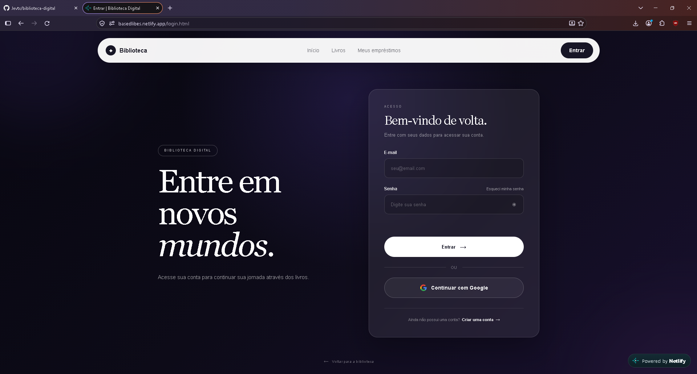
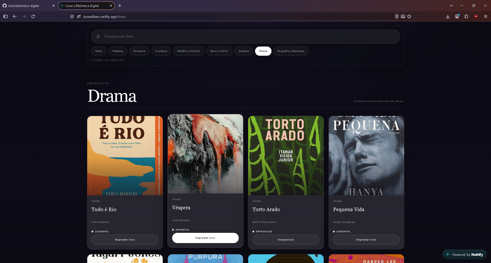
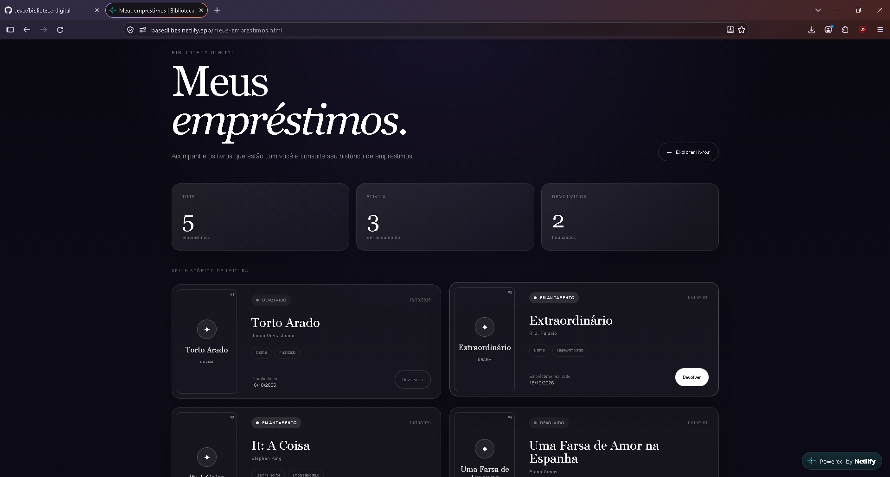
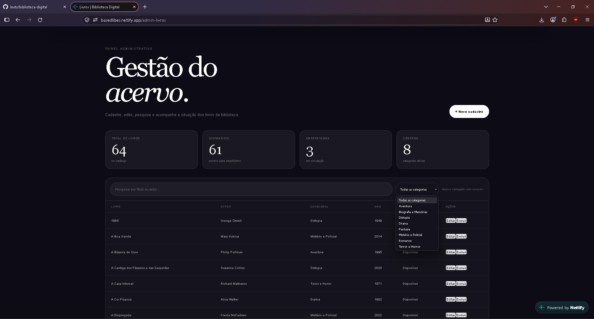
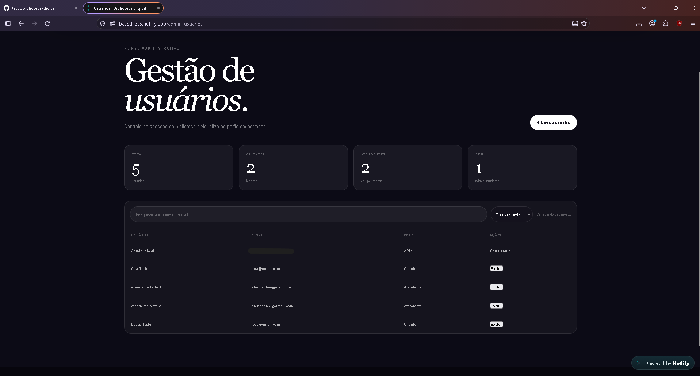
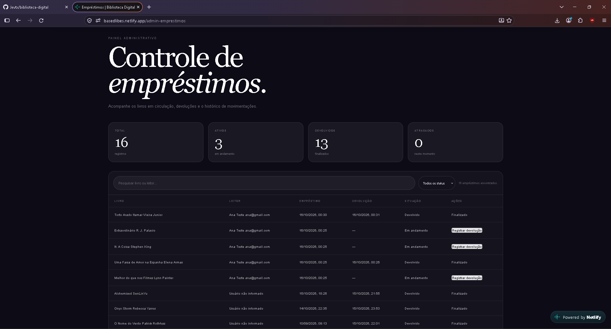

# Based Libes — Biblioteca Digital

Sistema web de gestão de biblioteca com catálogo, empréstimos e painel administrativo. Tem três perfis de acesso (cliente, atendente e administrador), login com e-mail e senha ou com Google e recuperação de senha por e-mail.

Projeto em grupo da disciplina *Engenharia de Software e Projeto Interdisciplinar II*, do Curso Técnico em Informática da Grau Técnico.


**Demo:** https://basedlibes.netlify.app

> O backend roda em plano gratuito. Depois de um tempo parado, a primeira requisição pode levar cerca de 1 minuto. Entrar com Google cria uma conta de Cliente automaticamente.

## Telas








## Funcionalidades por perfil

| Ação | Cliente | Atendente | Admin |
|---|:-:|:-:|:-:|
| Consultar o catálogo, pegar livro emprestado e devolver | ✔ | ✔ | ✔ |
| Ver o próprio histórico de empréstimos | ✔ | ✔ | ✔ |
| Cadastrar, editar e excluir livros | | ✔ | ✔ |
| Ver todos os empréstimos e registrar devolução | | ✔ | ✔ |
| Cadastrar e excluir usuários do tipo Cliente | | ✔ | ✔ |
| Cadastrar e excluir Atendentes e Admins | | | ✔ |

Quem se cadastra pelo site ou entra com Google recebe sempre o perfil Cliente. Ninguém exclui a própria conta.

## Como funciona

```
Navegador ──▶ Netlify (HTML, CSS e JavaScript)
                 │  requisições HTTPS com token JWT
                 ▼
             Render (API em Flask) ──▶ Firestore (usuários, livros, empréstimos, recuperações de senha)
                 │               └──▶ Firebase Authentication (valida o login com Google)
                 └──▶ Brevo (envia o e-mail de recuperação de senha)
```

## Tecnologias

| Camada | Tecnologias |
|---|---|
| Backend | Python, Flask, Flask-JWT-Extended, Firebase Admin SDK, gunicorn |
| Banco e autenticação | Cloud Firestore, Firebase Authentication (Google) |
| Frontend | HTML, CSS e JavaScript |
| E-mail | Brevo (API HTTPS) |
| Publicação | Netlify (frontend) e Render (API), com deploy automático a cada push |

## Segurança

- Senhas guardadas como hash (Werkzeug), nunca em texto puro.
- Autenticação por JWT, com o perfil de acesso conferido no backend em cada rota.
- Empréstimo e devolução em transações do Firestore, para dois usuários não pegarem o mesmo livro ao mesmo tempo.
- Recuperação de senha com token aleatório de uso único e validade de 30 minutos. O banco guarda só o hash do token, e a resposta é a mesma para e-mails cadastrados ou não.
- CORS restrito às origens autorizadas.
- Chaves e segredos em variáveis de ambiente, fora do repositório.

## Problemas que resolvi ao colocar no ar

- **Empréstimo e devolução falhavam nos testes.** O decorator estava como `@db.transactional`, que não existe no cliente do Firestore. O correto é `@firestore.transactional`, importado do módulo.
- **O e-mail de recuperação não chegava.** O log do Render mostrava que as variáveis de SMTP não estavam definidas. E, mesmo definidas, o plano gratuito do Render bloqueia as portas SMTP. Troquei o envio por SMTP pela API HTTPS da Brevo e validei lendo os logs.

## Como rodar localmente

Requisitos: Python 3.10 ou superior e um projeto no Firebase com o Firestore ativado e uma chave de conta de serviço.

```bash
git clone https://github.com/Jevtx/based-libes-biblioteca-digital.git
cd based-libes-biblioteca-digital/backend
python -m venv venv
source venv/Scripts/activate        # Windows (Git Bash). No Linux/macOS: source venv/bin/activate
pip install -r requirements.txt
cp .env.example .env                # preencha os valores (veja a lista abaixo)
python seed_admin.py                # cria o primeiro admin, pede e-mail e senha
python app.py                       # API em http://127.0.0.1:5000
```

Variáveis principais (`backend/.env.example` tem a lista completa):

| Variável | Para que serve |
|---|---|
| `JWT_SECRET_KEY` | Assina os tokens de login. Obrigatória. |
| `FIREBASE_CREDENTIALS_JSON` | Conteúdo da chave de serviço (ou use o arquivo `backend/serviceAccountKey.json`, que está no `.gitignore`) |
| `FRONTEND_URL` | Endereço do site, usado no link do e-mail de recuperação |
| `BREVO_API_KEY` e `EMAIL_FROM` | Envio do e-mail de recuperação. Sem elas o sistema funciona, mas esse e-mail não é enviado. |
| `CORS_ORIGINS` | Endereços do site autorizados a chamar a API, separados por vírgula. Em produção, a URL do Netlify. O localhost:5500 já vem liberado. |

Para o site, na raiz do projeto, rode `python -m http.server 5500` e abra `http://127.0.0.1:5500`. A URL da API fica em `js/config.js`.

## Equipe

| Integrante | Contribuição |
|---|---|
| Guilherme Willian | Modelagem das coleções, esqueleto do backend, configuração do Firebase e do Firestore, integração entre o site e a API, login com Google e recuperação de senha, correção de bugs do backend, publicação (Netlify e Render) e manutenção do repositório |
| Gabriel Ferreira | API: autenticação JWT e permissões, login e cadastro, CRUD de livros e de usuários, rotas de empréstimo e devolução |
| Lucas Rodrigues | Site: telas de login e cadastro, gestão de livros e de usuários, "Meus empréstimos" e controle geral de empréstimos |

Todos participaram dos testes finais. O grupo consultou ferramentas de IA (Claude) no backend e no frontend.

## Melhorias futuras

Nada disto está implementado:

- Testes automatizados das rotas principais (login, permissões e empréstimo simultâneo).
- Limite de tentativas de login.
- Enviar o e-mail de recuperação em segundo plano. Hoje o envio é feito durante a requisição, e a diferença de tempo pode revelar se um e-mail está cadastrado.
- Impedir a exclusão de usuários com empréstimo ativo.
- Atualizar as consultas do Firestore para o formato `where(filter=FieldFilter(...))`, que remove um aviso de depreciação.